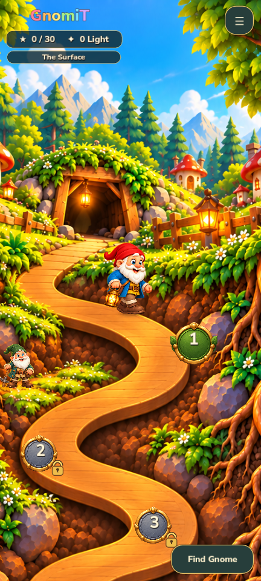
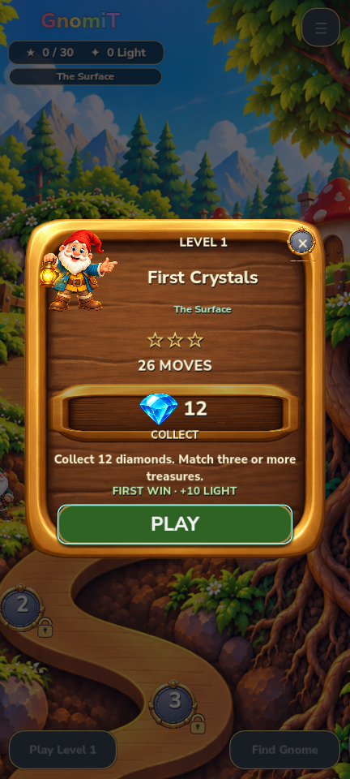

# GnomiT — temporary review and experiment sandbox

Separate public test repository: [Fuet-Goat/GnomiT-review-test](https://github.com/Fuet-Goat/GnomiT-review-test). The private game is not modified by work here.

This snapshot contains the latest **Vertical Slice 1 / First Bend** PC prototype: drag to browse, tap the reachable road to walk, stop without teleporting, arrival → goal/reward/Play, actual level-1 victory → unlock level 2, then return without losing progress.

## Start here

| Reviewer | Prompt | Full project | Branch | Current authority |
|---|---|---|---|---|
| GPT | [GPT prompt](prompts/PROMPT_FOR_GPT_BG.txt) | [GPT folder](sandbox/gpt/task-001/) | codex/gpt/task-001 | Own text reports only |
| Grok | [Grok prompt](prompts/PROMPT_FOR_GROK_BG.txt) | [Grok folder](sandbox/grok/task-001/) | codex/grok/task-001 | Own text reports only |

- [Shared discussion reports: Codex · GPT · Grok](discussions/INDEX.md).
- [Immutable source reference](baseline/game/) and [SHA-256 manifest](baseline/MANIFEST.json).
- [Current screenshots and real Godot runtime clip](media/current/).
- [Task approval and workflow (Bulgarian)](docs/APPROVAL_AND_WORKFLOW_BG.md).
- [Owner's task authorization template](prompts/OWNER_TASK_GRANT_TEMPLATE_BG.txt).
- [Implementation status and limitations](docs/IMPLEMENTATION_STATUS.json).
- [Downloads: existing Windows preview and public review ZIP](https://github.com/Fuet-Goat/GnomiT-review-test/releases).




## What this proves

The clip is rendered by Godot with scripted native touch gestures and actual match-3 swaps. It is not a human playtest, Android/Pixel 8a test or independent acceptance. New tap-to-walk covers only the first bend. Other content remains the existing alpha10 implementation. The six generated walking sprites are an initial study.

The source uses Godot 4.7.2. The PC window is **432×960**; logical canvas is 720×1600. After a human approves execution, open YOUR game/project.godot, or run:

```text
godot --editor --path sandbox/gpt/task-001/game
godot --path sandbox/gpt/task-001/game --resolution 432x960
```

For Grok, replace gpt with grok. Never import/run baseline as your working copy. Each bot copy has a different custom user-data directory. Gameplay/audio bytes are identical to baseline; only project.godot adds that isolation. Historical source documentation has one local machine path redacted. No private Git history, credentials or personal save is included.

## Change boundary

Own text reports in discussions/<bot>/task-001/ are authorized now (REPORTS_ONLY). No bot game implementation is authorized yet. Human authorization must name the bot, task, branch, exact folder, objective and tests. The owner registers it on main; the bot cannot approve itself. Changes stay in its folder and Draft PR. Only a later explicit human decision can move a reviewed patch into the private game.

Main requires a PR and the **Scope boundary** check; force push, deletion and auto-merge are disabled. Folder names are not independent GitHub write permissions. Public access allows reading; writing requires an authorized connected account. No new collaborators or credentials are provisioned here.

This repository is temporary. Deleting it later does not delete other people's copies/forks. Do not put secrets or private saves in it. Asset inclusion for review does not add a new redistribution license.
